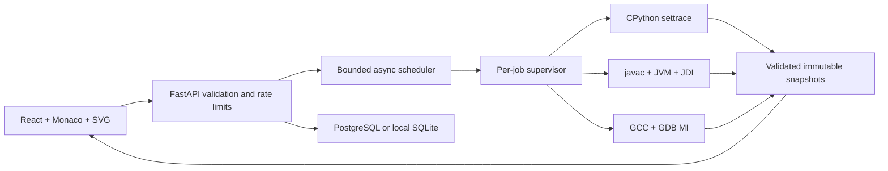

# Spandy Shows architecture

See your code, step by step.

The browser edits source in Monaco and submits a validated program to FastAPI. A bounded asynchronous scheduler accepts up to eight live jobs and runs two workers concurrently. Each worker records one real execution and returns schema-v1 JSON. API validation rejects oversized results, source mismatches, non-contiguous indices, malformed objects and dangling references. React renders text as escaped content, never as output HTML.

Job submissions accept `execution: "visualize" | "run"` (default `visualize` for backward compatibility). `JobRequest` extends the persisted `Program` schema, so saved/share payloads remain unchanged. Run mode bypasses CPython tracing, JDI and GDB, while retaining the same supervisor, compilation, stdin and output limits. It returns one final real observation; native run mode does not claim memory data it has not inspected. The browser initially selects that final output. Visualize retains immutable snapshot playback. Output uses a resize observer to fit banner columns, without clipping printed rows; memory inspection is an optional disclosure driven by actual records.

CPython observations are filtered to `main.py`. Exact built-in primitives and containers are read directly. Basic instance fields are accessed through the built-in `__dict__` descriptor, avoiding user getters/representations. Strongly retained identity keys prevent recycled Python IDs from merging objects during a trace. Serialization has bounded depth/size and handles cycles by registering records before visiting children.

Java source compiles with debug information. The JDI controller launches a suspended debuggee, filters user method entry/exit/stepping events, observes suspended stack frames, local variables, static fields, arrays, and user-class instance fields. It reads fields, never invokes target methods. JVM object IDs are preserved. Strings are value observations; standard-library object internals are deliberately unavailable.

C compiles with debug information and no optimization. A token-based MI controller waits for command replies and stop events. A bounded GDB Python observer collects user frames, declared symbols, nested array types and real values in one query per stop. Runtime-sized arrays are skipped before their declaration. Storage identity includes address and type; pointers can link to displayed fields or individual array cells without dereferencing unknown addresses. Small line tables use breakpoints on actual user line entries; larger line tables use normal line stepping to avoid repeatedly inserting thousands of breakpoints on Windows. A separate constructor helper redirects input/output and makes output unbuffered while retaining the submitted file's line mapping.

Local launch is a private explicit trusted-code mode. Container launch supervises a fresh unprivileged per-job container; compilation shares the same boundary. The parent watches active execution time (excluding user input waits), input idle time, memory, output, trace and disk usage, kills descendants/containers on cancellation and removes temporary workspaces. The API has no native execution in its own process.

PostgreSQL is configured in Compose. SQLite is the labeled local fallback. Saved-program IDs and share IDs use 192-bit random tokens. There are no accounts and no source listing endpoint. IDs provide capability-based reading, not user authentication. Stored source expires after 30 days. Jobs and traces are ephemeral, not share payloads.

The single-instance asynchronous queue intentionally avoids Redis. Multi-instance production deployment needs a durable bounded broker (e.g. Redis) and separate worker services; in-memory jobs, cancellation events and rate limits are not shared across instances.

## Interactive execution

Browser jobs set `interactive: true`; API clients can retain legacy pre-supplied stdin by leaving it false. A waiting worker publishes a bounded input request (`id`, user source line, type hint), live output, and an immutable trace checkpoint. `POST /api/jobs/{id}/input` validates the current request and publishes one atomic response. The same process resumes: source is never replayed to obtain the next prompt. Duplicate/stale input IDs are rejected. Queue limits, cancellation, memory/output/disk limits also apply to waiting jobs. The active budget is 60 seconds for Run code and 300 seconds for Visualize preparation; both exclude time awaiting a response; each input has a three-minute idle limit. Input is bounded to 4 KB / 128 responses per job.

CPython's stream adapter blocks in readline while retaining settrace frames. Java's excluded `SpandyRun` launcher installs a blocking InputStream; Scanner performs real parsing. JDI observes the inferred submitted source filename, including its user helper classes. The launcher passes the discovered entry class and source filename to both the JVM and debugger. C's broker feeds a real named pipe/FIFO while the original instrumented libc read is blocked; a partial scanf never restarts or assigns fabricated values. Read markers are removed after libc returns, so buffered bytes do not generate additional input prompts. Input-file publication and cleanup retry brief Windows reader sharing conflicts, including atomic replacement of C read markers; retries are bounded and permanent errors are not ignored.

GET job status streams actual output and pending input metadata. GET trace can return a validated checkpoint before completion. The browser opens at the first real recorded step, paused. New prefixes and final completion preserve the learner’s selected step. Playback remains available during preparation; Play waits at a recording frontier for more states and stops at an actual pending read. Input is enabled only when the learner reaches that read, with an explicit Go to input line shortcut. After completion, full replay remains available. Explanations compare snapshots, attribute changes to the preceding source line, and distinguish before-line state from the next instruction. Submitted input echo is presentation data and never alters raw stdout or trace values.
